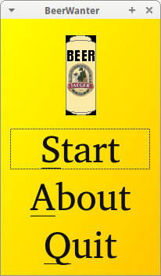
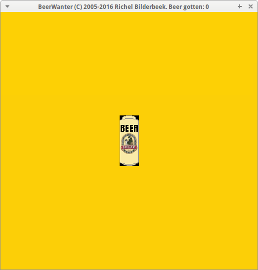

# Beer Wanter


[](https://github.com/richelbilderbeek/beer_wanter/actions/workflows/build.yml)

[Game](https://github.com/richelbilderbeek/Games) in which you have to click on the beer, written in C++ using Qt6.

[Play it in your browser](https://richelbilderbeek.github.io/beer_wanter/play/).





## Building

The [build workflow](.github/workflows/build.yml) produces a Linux version
(artifact `BeerWanter-linux-x86_64`) and a WebAssembly version
(artifact `BeerWanter-wasm`), and puts the game on the website.

Desktop, which needs Qt6 and Boost.Test:

```bash
cmake -S . -B build -DCMAKE_BUILD_TYPE=Release
cmake --build build
ctest --test-dir build
build/BeerWanterDesktop
```

WebAssembly, which needs Qt6 for WebAssembly, the desktop Qt6 of the same
version and the matching [Emscripten](https://doc.qt.io/qt-6/wasm.html):

```bash
/path/to/Qt/6.8.3/wasm_singlethread/bin/qt-cmake -S . -B build-wasm \
  -DCMAKE_BUILD_TYPE=Release -DQT_HOST_PATH=/path/to/Qt/6.8.3/gcc_64
cmake --build build-wasm
```

## External links

* [Richel Bilderbeek's games](https://github.com/richelbilderbeek/Games)
