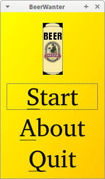
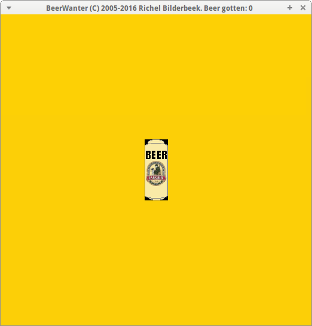

# Beer Wanter

Beer Wanter is a game in which you have to click on a beer.
and is one of
[Richèl Bilderbeek's games](https://richelbilderbeek.github.io/games).

Beer Wanter is written in C++ using Qt.

